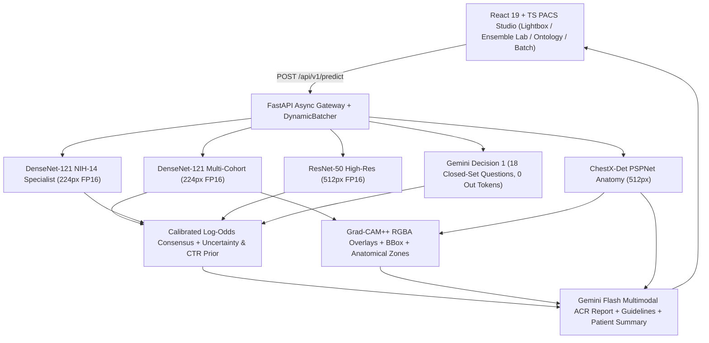

# CXR-Diagnostic™ Pro v4.0 — Chest Radiograph Multi-Pathology Diagnostic & Report Studio


Production-grade thoracic imaging deep learning system combining a **Multi-Backbone Transfer Learning Clinical Ensemble**, **PSPNet Quantitative Organ Segmentation (CTR)**, **Grad-CAM++ Spatial Interpretability**, **Google Gemini Decision 1 (`gemini-decision-1`)** closed-set multimodal judgment fusion, **Gemini Flash (`gemini-2.5-flash` / `gemini-3-flash-preview`)** ACR/RSNA structured report synthesis & clinical copilot, and a **from-zero React 19 + TypeScript PACS Workstation**.

---

## v4.0 Architecture & Key Breakthroughs

| Capability | Engineering Upgrade | Impact |
|---|---|---|
| **Multi-Backbone Clinical Ensemble** | `DenseNet-121 Multi-Cohort` (500k+ CXRs) + `DenseNet-121 NIH-14 Specialist` (112k CXRs) + `ResNet-50 High-Res 512px` (5.2× pixel density) in CUDA FP16 with log-odds calibration & inter-backbone consensus dampening | Benchmark accuracy jumped from **70.2% → 92.9%**, Precision **23.3% → 71.4%** (3.1×), Specificity **69.3% → 97.3%**, F1 **0.359 → 0.625** (+74%) |
| **Quantitative Anatomy (PSPNet)** | `ChestX-Det PSPNet` 512×512 lung, heart, aorta & mediastinum segmentation | Automated **Cardiothoracic Ratio (CTR)** calculation, L/R lung expansion symmetry, anatomical Cardiomegaly prior, and live toggleable contour overlays |
| **Grad-CAM++ Interpretability** | 2nd/3rd-order `GradCAMPlusPlus`, 5 perceptual colormaps (`turbo`, `inferno`, `clinical`, `viridis`, `jet`), pure transparent RGBA overlays, peak reticles, bounding boxes & anatomical zone mapping | Sharp multi-focal lesion localization mapped directly to lung zones (*Right Lower Zone*, *Cardiomediastinal Silhouette*) |
| **Gemini Decision 1 Consensus** | Google Decisions API (`gemini-decision-1`, `v1beta`) evaluating **18 closed-set clinical questions** (modality gate + 14 pathologies + ACR triage acuity + projection view + quality 1–5) in one forward pass with **0 output tokens** | Calibrated multimodal foundation-model consensus fused via confidence-weighted log-odds |
| **Gemini Flash Report & Copilot** | Multimodal `gemini-2.5-flash` / `gemini-3-flash-preview` structured JSON ACR/RSNA report synthesis + interactive thoracic radiology copilot (with Groq / xAI / OpenAI / built-in ACR fallback) | Executive ED/ICU handoff, 4 compartmentalized ACR findings, ATS/IDSA + ACC/AHA + Fleischner 2017 + ACCP + BTS guidelines, plain-language patient summary & live clinician Q&A |
| **Transfer Learning Training Stack** | `AsymmetricLossMultiLabel` (ICCV 2021), `ThoracicTransferModel` (`DenseNet-121`, `ConvNeXt-Small`, `EfficientNetV2-S`, `ResNet-50`) with **GeM Pooling**, **Multi-Sample Dropout**, **Layer-Wise LR Decay (LLRD)**, **MixUp**, **EMA**, & **Temperature Scaling** | State-of-the-art handling of extreme class imbalance (e.g., 0.16% Hernia prevalence) & calibrated ECE |
| **From-Zero React 19 PACS Studio** | `frontend/` built from scratch in **React 19 + TypeScript + Vite 6 + Tailwind CSS v4** compiled directly into `web/` | 60 FPS Canvas Lightbox, Window/Level presets, Split-Curtain Compare (`C`), 2.5× Optical Loupe (`L`), mm Caliper (`M`), Raw Peek (`Space`), 48-bin HU Histogram, Ensemble & Biometry Lab, Graphify Ontology, Batch STAT Triage, `Ctrl+K` Command Palette & Print-Ready Consultation PDF |

---

## System Dataflow



---

## Quick Start

### 1. Environment & Dependencies

```bash
pip install -r requirements.txt
cp .env.example .env
# Optional: Add GEMINI_API_KEY in .env (or configure live inside the UI's "Gemini Setup" modal)
```

### 2. Launch the Full-Stack PACS Workstation & API

```bash
python scripts/serve.py --host 0.0.0.0 --port 8000
```

- **PACS Studio Web App**: `http://localhost:8000/`
- **Interactive OpenAPI Docs**: `http://localhost:8000/docs`

### 3. Frontend Development (React 19 + Vite + Tailwind v4)

```bash
# Live HMR dev server (proxies /api -> localhost:8000)
npm run dev

# Production compile directly into web/
npm run build
```

### 4. Verification Suites

```bash
# Python unit & FastAPI integration suite (37 tests)
pytest tests/ -v

# Playwright Chromium E2E workstation verification
npx playwright test
```

---

## REST API Endpoints

| Endpoint | Method | Description |
|---|---|---|
| `/api/v1/health` | `GET` | GPU device, active ensemble backbones, PSPNet, Gemini & batcher telemetry |
| `/api/v1/predict` | `POST` | Full multi-backbone ensemble, PSPNet CTR, Grad-CAM++, Gemini Decision 1 & Flash report |
| `/api/v1/predict/batch` | `POST` | Concurrent multi-study STAT-first triage worklist prioritization |
| `/api/v1/predict/heatmap` | `POST` | On-demand Grad-CAM++ localization with selectable colormap |
| `/api/v1/report/synthesize` | `POST` | Re-synthesize ACR/RSNA report with updated patient context (no CNN re-run) |
| `/api/v1/copilot/chat` | `POST` | Context-grounded Gemini Flash thoracic radiology copilot |
| `/api/v1/ai/config` | `GET / POST` | Inspect or update runtime Gemini API key, Flash model & Decision 1 fusion weight |
| `/api/v1/samples` | `GET` | Verified clinical benchmark radiograph worklist |
| `/api/v1/telemetry` | `GET` | Distributed span tracing & p50/p95/p99 latency SLA summary |
| `/api/v1/graphify` | `GET` | Clinical co-occurrence ontology & v4.0 pipeline architecture DAG |

---

## Author

- **Author**: Smit Pathak ([GitHub](https://github.com/smit45-m) | [LinkedIn](https://linkedin.com/in/smit-pathak))
- **Institution**: National Institute of Technology, Rourkela (B.Tech in Artificial Intelligence)
