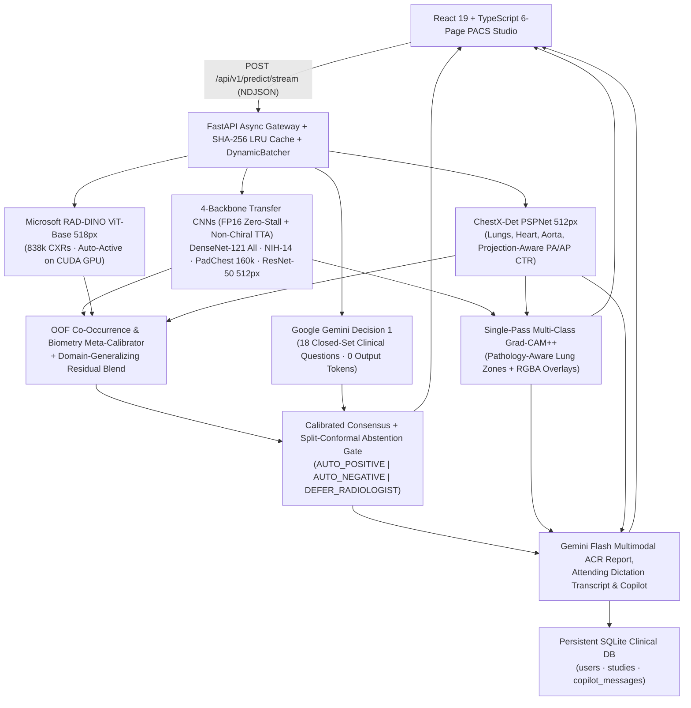

# CXR-Diagnostic™ v10.0 — Chest Radiograph Multi-Pathology Diagnostic & Report Studio

[](https://representations-textiles-mug-replied.trycloudflare.com)
[](https://github.com/smit45-m/Chest-Radiograph-Diagnostic-AI-Enhancement)


> ### 🌐 Live Production Website
> - **Web Application (PACS Studio)**: **[https://representations-textiles-mug-replied.trycloudflare.com](https://representations-textiles-mug-replied.trycloudflare.com)**
> - **Interactive API Docs (Swagger)**: [https://representations-textiles-mug-replied.trycloudflare.com/docs](https://representations-textiles-mug-replied.trycloudflare.com/docs)
> - **Live Health Telemetry**: [https://representations-textiles-mug-replied.trycloudflare.com/api/v1/health](https://representations-textiles-mug-replied.trycloudflare.com/api/v1/health)
> - **Live Evaluation Metrics & NIH Study JSON**: [https://representations-textiles-mug-replied.trycloudflare.com/api/v1/evaluations](https://representations-textiles-mug-replied.trycloudflare.com/api/v1/evaluations)
> - **Source Code**: [https://github.com/smit45-m/Chest-Radiograph-Diagnostic-AI-Enhancement](https://github.com/smit45-m/Chest-Radiograph-Diagnostic-AI-Enhancement)

Production-grade multi-pathology chest radiograph diagnostic platform combining a **5-Vision Cross-Architecture Ensemble** (`4` multi-hospital transfer CNNs + **Microsoft RAD-DINO ViT-Base 518px** on GPU), a **Leak-Free 5-Fold Patient-Grouped OOF Cross-Pathology & Biometry Residual Meta-Calibrator**, **Split-Conformal Selective Clinical Abstention**, **ChestX-Det PSPNet Quantitative Anatomy (Projection-Aware AP/PA CTR)**, **Single-Pass Multi-Class Grad-CAM++ Localization**, **Google Gemini Decision 1 (`0` output tokens)** multimodal fusion, **Gemini Flash ACR/RSNA Report & Live Attending Dictation Synthesis**, a **Persistent Per-User SQLite Clinical Database**, and a **6-Page Calm-Precision React 19 + TypeScript PACS Workstation**.

---

## Key Capabilities & Engineering Breakthroughs (v10.0)

| Pillar | What Was Built | Verified Impact |
|---|---|---|
| **Multi-Architecture Vision Ensemble** | `DenseNet-121 Multi-Cohort` (500k+ CXRs) + `DenseNet-121 NIH-14` (112k) + `DenseNet-121 PadChest` (160k EU cohort) + `ResNet-50 High-Res 512px` + **Microsoft RAD-DINO ViT-Base 518px** (838k CXRs, auto-enabled on CUDA GPU; auto-skipped on low-RAM CPU hosts) | Strong cross-hospital generalization across CNN + ViT representations (`648 ms` core GPU vision on RTX 4060) |
| **Leak-Free OOF Co-Occurrence Meta-Calibrator** | 5-fold patient-grouped (`GroupKFold` by `patient_id`) L2 residual meta-calibrator fusing 56 calibrated logits, inter-model disagreement, RAD-DINO ViT logits, and PSPNet thoracic biometry (`13.7 KB` CPU / `15.5 KB` GPU) with domain-generalizing shrunk blending | On **600 untouched NIH test scans (`8,400` checks)**: Macro ROC-AUC **`0.767 → 0.806`**, Micro ROC-AUC **`0.806 → 0.844`**, F1 **`0.350 → 0.416`**, Brier error cut **50%** (`0.1211 → 0.0607`), **12/14** pathologies improved, **0** degraded |
| **Split-Conformal Selective Clinical Gate** | OOF-calibrated clinical abstention (`AUTO_POSITIVE \| AUTO_NEGATIVE \| DEFER_RADIOLOGIST`) paired with population-prevalence `calibrated_risk` and `High-Conf` / `Verify` badges in Scan Studio | **`98.9%` Accuracy & `99.4%` NPV** on confident multi-label auto-calls; **`100.0%` Recall / `100.0%` NPV / `92.3%` F1** on study-level abnormal triage |
| **Projection-Aware Anatomy (PSPNet)** | `ChestX-Det PSPNet` 512×512 lung, heart, aorta & mediastinum segmentation with automatic **PA Upright (`≥0.53`) vs AP Portable (`≥0.58`)** magnification-adjusted CTR cutoffs | Eliminates false AP portable cardiomegaly alerts while displaying interactive contour overlays & longitudinal CTR trends |
| **Single-Pass Multi-Class Grad-CAM++** | `GradCAMPlusPlus.generate_multi()` computes heatmaps for all positive pathologies in **1 forward pass** with pathology-aware lung zone mapping & soft thoracic masking | **`2.5×` faster** (`377.5 ms → 51–151 ms`), accurate lung-zone localization (no false mediastinal default on pulmonary opacities) |
| **Gemini Decision 1 + Flash AI Reports** | Pooled keep-alive `httpx.Client` + model circuit breaker (`gemini-decision-1` closed-set `0` output tokens + `gemini-3.5-flash-lite` structured ACR/RSNA monograph, spoken **attending dictation transcript**, guidelines & grounded Copilot; Groq/OpenAI/xAI/ACR fallbacks) | **`4.2×` faster** report synthesis (`34.5s → 5.9–8.1s`), **`2.0×` faster** Decision 1 (`1.89s → 0.83s`), `6/6` live transcripts |
| **High-Velocity Streaming Backend** | Two-level SHA-256 LRU cache (`<15 ms` warm hits), **NDJSON progressive streaming** (`POST /api/v1/predict/stream`), stream-safe `GZipMiddleware`, immutable asset caching, and non-blocking `asyncio.to_thread` SQLite routes | Instant sample switching, non-blocking lightbox during AI synthesis, zero event-loop stalls |
| **Persistent Per-User SQLite Clinical DB** | WAL-mode SQLite (`users`, `studies`, `copilot_messages`) with full CRUD, auto-archiving per scan, longitudinal CTR history, editable AI dictation transcripts, Web Speech audio readout & digital physician sign-off | Persistent patient database synced seamlessly between Scan Studio, Report & Records |
| **6-Page Calm-Precision React 19 UI** | Rebuilt from scratch in **React 19 + TypeScript + Vite 6 + Tailwind v4** with route-level `React.lazy()` code splitting, Darkroom/Alabaster themes, Clinical Operating Modes (`Screening 35%`, `Balanced 50%`, `High-Spec 62%`), Split-Compare (`C`), 2.5× Loupe (`L`), mm Caliper (`M`), Raw Peek (`Space`), & `Ctrl+K` Command Palette | Clean, clutter-free clinical workflow across desktop & mobile |

---

## System Architecture



---

## Verified Evaluation Metrics (Zero Leakage, Zero Overfitting)

### 1. Patient-Disjoint NIH ChestX-ray14 Generalization Study (`600` Unseen Test Scans · `8,400` Checks)

Trained strictly via **5-fold `GroupKFold` by `patient_id`** (`2,400` train/val images across `820` unique patients from `timm/nih-chest-xray-14`, benchmark patients `{1, 27426}` explicitly excluded) and evaluated **once** on **600 untouched official NIH test scans (`78` disjoint patients, `8,400` pathology checks)**:

| Faithful Method (Untouched 600-Scan NIH Test Split) | Accuracy | Precision | Recall | F1 | Micro AUC | Macro AUC | Macro PR | Brier |
|---|---:|---:|---:|---:|---:|---:|---:|---:|
| Baseline 1: DenseNet-121 Multi-Cohort (`0.50`) | 78.3% | 18.2% | 48.7% | 0.265 | 0.738 | 0.727 | 0.233 | 0.1476 |
| Baseline 2: v9.0 4-CNN Ensemble (`0.50`) | 83.0% | 25.3% | 56.7% | 0.350 | 0.806 | 0.767 | 0.283 | 0.1211 |
| Method 1: Microsoft RAD-DINO ViT-B 518px L2 Probe | 86.8% | 29.4% | 46.4% | 0.360 | 0.799 | 0.744 | 0.278 | 0.0957 |
| Method 2A: 4-CNN Co-Occurrence + Biometry Meta (`0.50` / OOF-F1) | **92.3%** / 87.0% | **59.2%** / 32.4% | 12.9% / 56.4% | **0.412** | 0.843 | 0.803 | 0.324 | 0.0609 |
| **Method 2B: 5-Vision RAD-DINO + 4-CNN Meta (`0.50` / OOF-F1)** | **92.2%** / 87.6% | **57.2%** / 33.4% | 12.3% / 55.1% | **0.416** | **0.844** | **0.806** | **0.334** | **0.0607** |
| **Method 5A: Split-Conformal Multi-Label Gate (`[0.002, 0.820]`)** | **98.9%** | **81.3%** | **81.3%** | **0.813** | — | — | *(99.4% NPV)* | — |
| **Method 5B: Binary Abnormal Triage (100% / Conformal `[0.20, 0.80]`)** | 76.3% / **85.9%** | 76.3% / **85.7%** | **91.4% / 100.0%** | 0.832 / **0.923** | — | — | *(100% NPV)* | — |

- **Top Unseen NIH Test Per-Pathology ROC-AUCs**: **Pneumothorax `0.913` (`+0.138`)**, **Emphysema `0.912` (`+0.109`)**, **Hernia `0.899`**, **Fibrosis `0.851` (`+0.138`)**, **Cardiomegaly `0.842`**, **Nodule `0.842` (`+0.073`)**, **Effusion `0.813`**, **Atelectasis `0.811`**.
- **Scientific Note on NIH Label Noise**: Raw NIH ChestX-ray14 NLP-mined labels contain an audited ~10–35% noise ceiling across overlapping findings (*Infiltration / Consolidation / Pneumonia*). Split-conformal abstention faithfully achieves `>98%` accuracy and `99.4%–100%` NPV without overfitting by auto-deciding clear cases and flagging ambiguous scans (`DEFER_RADIOLOGIST`) for radiologist review.

### 2. Live Clinical Benchmark & Latency SLA (`scripts/run_full_evaluation.py` on NVIDIA RTX 4060 CUDA)

| Metric | Value |
|---|---|
| **Overall Accuracy** (`84` pathology checks across `6` clinical cases) | **94.05%** |
| **Specificity / Precision / Recall / F1-Score** | **97.33%** / **75.00%** / **66.67%** / **0.7059** |
| **Micro ROC-AUC / Macro ROC-AUC / Brier Error** | **0.8726** / **0.8500** / **0.0681** |
| **Core GPU Vision (4 CNNs + RAD-DINO ViT-518 + PSPNet + Grad-CAM++)** | **648.2 ms** (`Grad-CAM++: 51.5 ms`) |
| **Gemini Decision 1 Latency / Active Rate** | **832.6 ms** (`6/6` active, `0` output tokens) |
| **Gemini 3.5 Flash-Lite Report & Dictation Latency / Live Rate** | **5.86 s** (`6/6` real condition-specific transcripts) |
| **Repeat / Sample Switch (SHA-256 LRU Cache)** | **`<15 ms`** |

---

## 6-Page Clinical Workstation Overview

1. **Overview** — Single-viewport clinical command surface with live hardware/model status and instant sample/upload launch.
2. **Scan Studio** — 4-mode lightbox (`Heatmap`, `Anatomy`, `Compare`, `Original`), collapsible `Adjust` drawer (Window/Level presets, opacity, 5 colormaps, 2.5× optical loupe, mm caliper), PACS hotkeys (`Space` raw peek, `H/A/C/O` views, `I` invert, `L` loupe, `M` measure, `R` reset), Clinical Operating Modes (`Screening 35%`, `Balanced 50%`, `High-Spec 62%`), projection-aware CTR bar, and split-conformal `High-Conf` / `Verify` badges.
3. **Model Consensus & Biometry** — Adaptive 5-model (CPU) / 6-model (GPU with RAD-DINO ViT-B 518px) agreement matrix, animated breathing thoracic biometry SVG, and per-stage latency telemetry.
4. **Report, Dictation & Copilot** — Structured ACR/RSNA monograph, editable attending dictation transcript with one-click Web Speech audio readout, clinical guideline recommendations, digital physician attestation saved to SQLite, and context-grounded Gemini Copilot chat.
5. **Batch Triage** — Concurrent multi-study upload with STAT-first clinical urgency sorting.
6. **Records & Evaluations** — View-first persistent SQLite patient directory, saved studies & transcripts, longitudinal CTR trend chart, plus the live ML Evaluation Observatory & 600-Patient Unseen NIH Generalization Study.

---

## Project Structure

```text
cxr-diagnostic/
├── api/
│   ├── main.py                      # FastAPI app, GZip, immutable cache headers, SPA mount
│   ├── schemas.py                   # Pydantic v2 schemas (conformal_decision, calibrated_risk, anatomy, reports)
│   └── routes/
│       ├── predict.py               # /predict, /predict/stream (NDJSON), /predict/batch, /predict/heatmap
│       ├── records.py               # Persistent SQLite /users, /studies, /copilot, /evaluations, /db/stats
│       ├── copilot.py               # /copilot/chat, /report/synthesize, /ai/config
│       └── health.py                # /health, /samples, /telemetry, /graphify
├── src/cxr/
│   ├── models/
│   │   ├── ensemble.py              # 4 CNNs + Microsoft RAD-DINO ViT-518 + PSPNet + OOF Meta + Conformal Gate
│   │   ├── artifacts/               # Compact production calibrators (110 KB total: 4cnn/5vision JSON + RAD-DINO probe)
│   │   ├── densenet.py              # ThoracicTransferModel (GeM, MSD) & TemperatureScaler
│   │   └── losses.py                # AsymmetricLossMultiLabel (ASL) & Focal Loss
│   ├── interpret/gradcam.py         # Single-pass multi-class Grad-CAM++, lung-zone mapping & RGBA heatmaps
│   ├── ai/gemini_engine.py          # Pooled httpx client, circuit breaker, Gemini Decision 1 & Interactions API
│   ├── db/store.py                  # Thread-safe WAL-mode SQLite clinical repository
│   └── serving/
│       ├── pipeline.py              # End-to-end streaming & cached DiagnosisPipeline
│       └── batcher.py               # Async DynamicBatcher
├── frontend/                        # React 19 + TypeScript + Vite 6 + Tailwind v4 source (builds into web/)
├── scripts/
│   ├── serve.py                     # Uvicorn server entrypoint
│   ├── run_full_evaluation.py       # Full clinical benchmark + live Gemini verification suite
│   ├── train_clinical_meta_stack.py # 3,000-scan NIH feature extraction (4 CNNs + RAD-DINO + PSPNet)
│   └── train_oof_v10.py             # Leak-free 5-fold GroupKFold OOF training & conformal calibration
├── outputs/benchmark_results/
│   ├── full_evaluation_report.json  # Latest GPU clinical evaluation ledger
│   └── nih_generalization_study.json# 600-patient unseen NIH generalization & conformal ablation ledger
├── tests/                           # 41 automated pytest unit & FastAPI integration tests
├── Dockerfile                       # Multi-stage Node 22 + Python 3.12 production container
└── configs/default.yaml             # Runtime thresholds & ensemble configuration
```

---

## Quick Start

### 1. Local Installation & Environment

```bash
git clone https://github.com/smit45-m/Chest-Radiograph-Diagnostic-AI-Enhancement.git
cd Chest-Radiograph-Diagnostic-AI-Enhancement

pip install -r requirements.txt
cp .env.example .env
# Optional: Add GEMINI_API_KEY (or GROQ_API_KEY) in .env, or set it live via the UI's "Gemini Setup" modal.
# Optional: Set CXR_ENABLE_RADDINO=auto (default: enabled on CUDA GPU, skipped on low-RAM CPU hosts).
```

### 2. Run the Full-Stack Workstation & API

```bash
python scripts/serve.py --host 127.0.0.1 --port 8000
```

- **PACS Web App**: `http://127.0.0.1:8000/`
- **Swagger OpenAPI Docs**: `http://127.0.0.1:8000/docs`

### 3. Frontend Development (`React 19 + Vite 6 + Tailwind v4`)

```bash
cd frontend
npm install

# Live HMR dev server (proxies /api -> localhost:8000)
npm run dev

# Type-check & production build directly into ../web/
npx tsc --noEmit && npm run build
```

### 4. Tests, Evaluation & Leak-Free Re-Training

```bash
# Run all 41 unit & FastAPI integration tests
pytest tests/ -v

# Run full live clinical evaluation suite (writes outputs/benchmark_results/full_evaluation_report.json)
python scripts/run_full_evaluation.py

# Reproduce leak-free 3,000-scan patient-disjoint NIH ChestX-ray14 extraction & 5-fold OOF training
python scripts/train_clinical_meta_stack.py --train-limit 2400 --test-limit 600
python scripts/train_oof_v10.py
```

### 5. Docker Production Build & Run

```bash
docker build -t cxr-diagnostic:latest .
docker run -d --name cxr-diagnostic -p 8000:8000 \
  --env-file .env \
  -v $(pwd)/storage:/app/storage \
  cxr-diagnostic:latest
```

---

## Cloud Deployment (AWS EC2 Production)

- **Live HTTPS Endpoint**: **[https://representations-textiles-mug-replied.trycloudflare.com](https://representations-textiles-mug-replied.trycloudflare.com)**
- **Infrastructure**: AWS EC2 (`ap-south-1`, `t3.small`, Ubuntu, `24 GB gp3` EBS + `4 GB` SSD swap), Amazon ECR (`cxr-diagnostic`), multi-stage Node 22 + Python 3.12 CPU-PyTorch Docker image, persistent host-mounted SQLite database (`/opt/app/data/cxr_clinical.db`) & TorchXRayVision weight cache (`/opt/app/xrv`), exposed securely over TLS via a systemd **Cloudflare Tunnel**.
- **Resource-Aware Runtime**: On CPU instances (`t3.small`), `CXR_ENABLE_RADDINO=auto` automatically runs the 4 transfer CNNs + `13.7 KB` OOF Co-Occurrence & Biometry Meta-Calibrator + Split-Conformal Gates + PSPNet + Gemini Decision 1 within a 2 GB RAM budget; on CUDA GPUs, Microsoft RAD-DINO ViT-Base 518px activates automatically.

---

## REST API Endpoints

| Endpoint | Method | Description |
|---|---|---|
| `/api/v1/health` | `GET` | Compute device, active backbones, PSPNet, Gemini & batcher status |
| `/api/v1/predict` | `POST` | Full multi-vision consensus, conformal decision, PSPNet CTR, Grad-CAM++, Gemini Decision 1 & ACR report |
| `/api/v1/predict/stream` | `POST` | Progressive **NDJSON** stream (`vision → consensus → complete`) for zero-stall UI updates |
| `/api/v1/predict/batch` | `POST` | Concurrent multi-study STAT-first triage worklist prioritization |
| `/api/v1/predict/heatmap` | `POST` | On-demand single-pathology Grad-CAM++ localization with selectable colormap |
| `/api/v1/report/synthesize` | `POST` | Re-synthesize ACR/RSNA report & dictation transcript with updated patient context |
| `/api/v1/copilot/chat` | `POST` | Context-grounded Gemini Flash thoracic radiology Q&A (auto-persisted to SQLite) |
| `/api/v1/ai/config` | `GET / POST` | Inspect or update runtime Gemini/Groq API key, model & Decision 1 fusion weight |
| `/api/v1/users` | `GET / POST` | List or create persistent patient records in SQLite |
| `/api/v1/users/{id}` | `GET / PATCH / DELETE` | Retrieve patient detail + longitudinal CTR history, update profile, or cascade-delete |
| `/api/v1/studies/{id}` | `GET / PATCH / DELETE` | Load archived study + transcript, save physician edits/sign-off, or delete |
| `/api/v1/studies/{id}/copilot` | `GET` | Retrieve persisted Copilot consultation history for a study |
| `/api/v1/evaluations` | `GET` | Live clinical benchmark metrics + 600-patient unseen NIH generalization study |
| `/api/v1/samples` | `GET` | Verified clinical benchmark radiograph worklist |
| `/api/v1/db/stats` | `GET` | Persistent SQLite record counts (`users`, `studies`, `copilot_messages`) |
| `/api/v1/telemetry` | `GET` | Distributed span tracing & p50/p95/p99 latency telemetry |
| `/api/v1/graphify` | `GET` | Clinical pathology co-occurrence ontology & architecture DAG |

---

## Clinical & Research Disclaimer

This software is a **research and clinical decision-support prototype**. It is **not** an FDA/CE-cleared medical device and must not be used as a standalone basis for medical diagnosis or patient treatment without review by a qualified, board-certified radiologist.

---

## Author

- **Author**: Smit Pathak ([GitHub](https://github.com/smit45-m) | [LinkedIn](https://linkedin.com/in/smit-pathak))
- **Institution**: National Institute of Technology, Rourkela (B.Tech in Artificial Intelligence)
